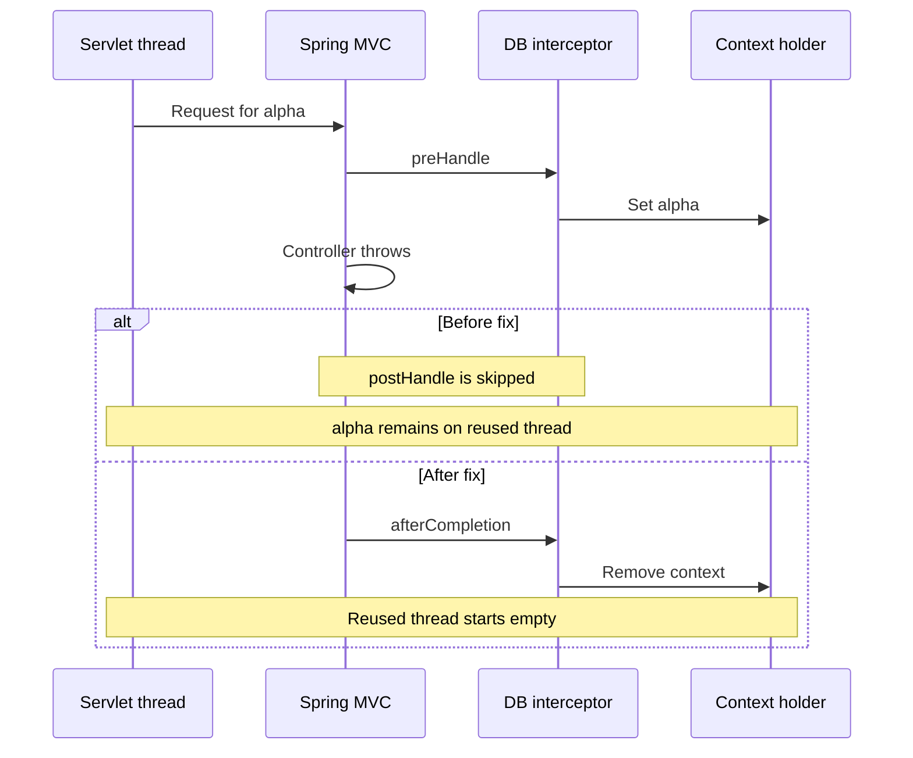

# Database routing context lifecycle (#958)

## Scope

A database ID stored on a servlet thread must belong only to the current request. Cleanup must run when a controller, a later interceptor, or an exception handler fails, and before an asynchronous request releases the servlet thread.

The fix clears stale context at the start of `preHandle`, retains the route through synchronous result rendering, and clears it in `afterCompletion` or `afterConcurrentHandlingStarted`. A resumed async dispatch runs `preHandle` again and selects its own route from path variables. Whitelist requests start without a database route.

No endpoint, database identifier contract, or default datasource behavior changes.

## Context inventory

| Source | Context dependency | Decision |
| --- | --- | --- |
| `DatabaseContextHolder` | Plain `ThreadLocal<String>`; no inheritance | Keep request-bound storage and `remove()` cleanup. |
| `DatabaseContextRequestInterceptor` | Only production writer | Clear before validation, after completion, and at async handoff. |
| `RoutingDataSource.determineCurrentLookupKey` | Only production reader | Keep the lookup behavior unchanged. |
| `DbServiceConfiguration` | Builds the routing datasource | No assignment or propagation of thread-local context. |
| `JdbcManager.loadAllMetaData` | Enumerates resolved physical datasources | No thread-local assignment; creates per-database JDBC and transaction templates. |
| JDBC services | Select templates through explicit `dbId`/context DTOs | No ambient route propagation needed. |
| `BulkCreateController` and async `JdbcBulkCreateService` | Pass `BulkContext.dbId` to database operations | Keep explicit database selection in worker tasks. |

Search used: `DatabaseContextHolder`, `getCurrentDbId`, `setCurrentDbId`, and `RoutingDataSource`. There are no production non-request context assignments to wrap in `try/finally` at the inspected base commit.

Invalid-route diagnostics use constant messages at DEBUG without request paths, path-variable maps, database IDs or credentials.

## Failure path: before and after



Async handoff follows a separate lifecycle: `preHandle` selects the request route, `afterConcurrentHandlingStarted` removes it before the servlet thread returns to the pool, worker code uses explicit database selection, and a later dispatch selects then clears its own context. A timeout/error that never dispatches again therefore cannot leave the original servlet thread's route behind.

## Verification

Inspected base: `9971d5dadc8aa391e0ca5de1fd2c104929150a86`.

- The 19 lifecycle regression cases against unchanged production code produced 17 assertion failures and one executor-wrapped assertion error; the successful synchronous-request control passed.
- With the fix, all 19 cases passed. Coverage includes six whitelist routes, malformed route metadata, handled/unhandled controller exceptions, a failing exception handler, a later interceptor failure, a single reused executor thread, async success, and timeout/error result redispatch.
- Three integration cases use two separate in-memory SQLite databases and the actual `RoutingDataSource`: normal database selection, database failure followed by an admin/other-database request, and an async query with explicit database selection.
- The two existing metadata-controller test classes passed: nine cases.
- Combined result: **31 tests, zero failures/errors/skips**, on Temurin Java 21.0.12.1 and Maven 3.9.11.

```bash
./mvnw -pl db2rest-api/api-rest -am \
  -Dtest=DatabaseContextRequestInterceptorTest,DatabaseRoutingContextIntegrationTest,DbInfoControllerTest,SchemaControllerTest \
  -Dsurefire.failIfNoSpecifiedTests=false test
```

The cloud run attached Mockito's existing 5.17.0 jar as a Java agent via `argLine` for the existing controller mocks. No repository build configuration was changed for that environment detail.

This is focused MVC/JDBC verification, not a claim that the full existing Testcontainers database matrix passed. Docker is unavailable in the authoring workspace; upstream/full integration CI still needs review. The timeout case injects Spring's timeout exception as a deferred result and verifies dispatch cleanup; it does not simulate a container's timer clock.
