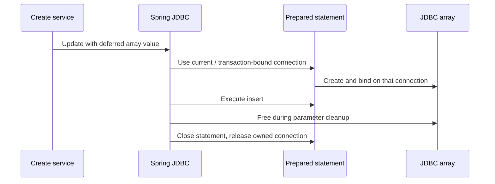

# JDBC array resource ownership (#959)

## Failure and fix

The previous `processArrayValue` borrowed a physical datasource connection directly, created an array and returned it without releasing either resource. `NamedParameterJdbcTemplate.update` then acquired its own connection, bypassing the transaction-bound connection during array creation.

`JdbcArrayValue` defers conversion until Spring binds the prepared statement. It creates the array through `PreparedStatement.getConnection()`, binds it, and releases it through Spring's `SqlValue.cleanup()` callback before statement/connection cleanup. There is no direct datasource acquisition in the array path. Spring continues owning connection acquisition, commit/rollback and release.



## Cleanup and error rules

- A value is private to one create call. Repeated use of the same named parameter reuses its array; cleanup is idempotent even when Spring visits that value twice.
- Arrays created before a later conversion, binding or execution failure are still freed.
- Conversion/binding SQL exceptions become `GenericDataAccessException` with the existing constant public message. The original cause is retained, without `printStackTrace` or logging connection objects.
- If a driver throws from `Array.free()`, cleanup emits a constant warning and continues. Throwing from parameter cleanup could prevent Spring from closing the statement and releasing its connection, or replace the original operation failure. A successful insert is not retroactively reported as failed solely for this cleanup warning.
- For PostgreSQL JDBC 42.7.7, `PgArray.free()` clears its connection and cached array representations; it performs no server operation. The cleanup-failure test uses a mock to cover other driver behavior.

## Supported scope

The existing PostgreSQL dialect converts `_varchar` inputs into `ArrayTypeValueHolder`. This change preserves that mapping; it adds no new database types or dialect support. If a driver rejects `createArrayOf` (including `SQLFeatureNotSupportedException`), conversion fails deterministically and Spring releases the connection. Scalar create operations and batch operations retain their existing paths.

## Verification

Inspected base: `9971d5dadc8aa391e0ca5de1fd2c104929150a86`.

The ten new unit cases produced nine assertion failures against unchanged upstream code; the scalar-insert control passed. All ten passed with the fix, together with the two existing `JdbcCreateServiceTest` cases on Java 21.0.12.1 and Maven 3.9.11.

`PgJdbcArrayResourceTest` covers twelve inserts through a pool capped at two connections, empty/quoted/comma/Unicode/null array elements, transaction connection count and commit visibility, conversion/execution rollback, pool recovery and repeated named parameters. These cases require Docker and PostgreSQL through Testcontainers; their observed CI results belong in the PR verification record.

```bash
./mvnw -pl db2rest-api/api-rest -am \
  -Dtest=JdbcOperationServiceArrayTest,JdbcCreateServiceTest,PgJdbcArrayResourceTest,PgReadControllerTest,PgCreateControllerTest,PgMultiTenancyTest \
  -Dsurefire.failIfNoSpecifiedTests=false test
```

The cloud unit run attached Mockito 5.17.0 as a Java agent via `argLine`. No upstream build configuration was changed for that environment detail. The focused selection is not the full upstream database matrix.
